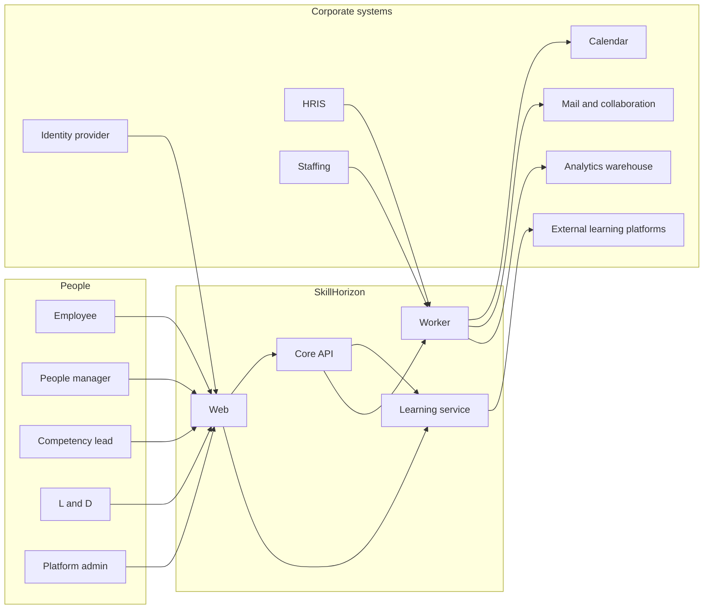

# System context

SkillHorizon sits between five human authorities and the corporate systems that already know who people are. The platform does not replace those systems.

## People

Corporate sign-in lands on the web. The core API then resolves that person’s workspaces. One workspace opens the shell directly. Two or more workspaces stop on an entry screen that lists only those workspaces. The shell that follows is the chosen workspace. Routes that belong to another workspace, including one the same person holds, are not in that shell.

| Workspace | Primary modules |
|-----------|-----------------|
| Employee | Web, learning service for sittings and progress, core API for the benchmark behind them |
| People manager | Web, core API, learning service for progress they are allowed to see |
| Competency lead | Web, core API |
| L&D | Web, core API, learning service for assessment operations and external-learning setup |
| Platform admin | Web, core API, worker operations |

## Platform

Four deployables in the current platform. Their responsibilities and data stores are specified in [03-containers-and-data.md](./03-containers-and-data.md). Mira is deprioritized and is not one of them.

| Deployable | Responsibility |
|------------|----------------|
| Web | SSO handoff, workspace entry, then the shell for the active workspace |
| Core API | Taxonomy, job profiles, benchmarks, attestation, activation, readiness, workspace resolution, admin configuration |
| Learning service | Assessments, learning progress, and connectors to external learning platforms |
| Worker | HR and staffing sync, calendar booking, notifications, exports, projection rebuilds |

## Corporate systems

| System | Flow | Payload class |
|--------|------|----------------|
| Identity provider | Sign-in to web | Authentication only. Group membership may hint at admin or L&D grants. It does not define a manager’s team |
| HRIS | Into the worker, then the workforce projection | Employee id, legal entity, country, location, manager, employment status, workforce framework |
| Staffing | Into the worker | Current assignment, used as context on a path. Optional at first launch if the feed is not trustworthy |
| Calendar | Worker books and reads slots | Appointment references. Sitting state stays in SkillHorizon |
| Mail and collaboration | Worker sends | Notifications and deep links. No item content, no raw responses |
| External learning platforms | Learning service assigns an activity and receives progress and completion | Course content and the player stay on the external site. SkillHorizon stores the assignment and the progress it is given |
| Analytics warehouse | Worker pushes aggregates | Counts, distributions, benchmark coverage. Not item responses, not evidence files |

External learning is part of the platform shape from the start. The first release may ship with SkillHorizon’s own assessments only, but a step in a path can already name an external provider. Adding a platform later is a new connector, not a change to where progress is stored. The warehouse remains a later export.

## Trust at the boundary

- The browser holds a session bound to one active workspace. It does not hold a credential that can read the item bank, and it cannot call another workspace’s commands with that session.
- A SkillHorizon sitting uses a short-lived token. Item text is not written into core API logs.
- The learning service is the only component that calls external learning platforms. The worker calls HR, staffing, calendar, notification, and warehouse endpoints.
