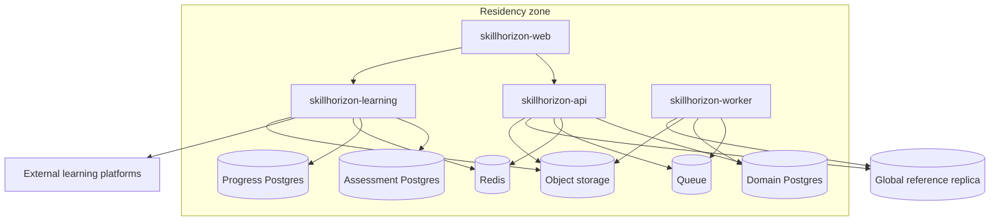

# Containers and data

## Shape

The core domain is one modular monolith. Learning and the worker are separate deployables. Learning owns assessments, learning progress, and connectors to external learning platforms, because that runtime talks to other companies’ systems and holds the item bank. Splitting taxonomy, benchmarks, and attestation into their own network services would add failure modes without adding a trust boundary. Mira is deprioritized and has no deployable in the current platform.

Each residency zone runs this set for the people whose personal data belongs in that zone. Global reference data (published taxonomy and published benchmark versions) is replicated in, read-only. See ADR-001 in [06-decisions.md](./06-decisions.md).

## Deployables

### skillhorizon-web

A static client plus a thin session boundary. It completes OIDC, asks the core API which workspaces this person holds, and either opens the only one or shows the workspace entry screen. The shell that follows is bound to the chosen workspace. Domain rules do not live here. The client calls the core API for benchmark and workforce workflows, and calls the learning service for a sitting or for progress on a path, including a handoff to an external learning site.

### skillhorizon-api

The system of record for the standard and for who is admitted to it: taxonomy, job profiles, benchmarks, attestation, activation, access, and readiness projections. It does not store item responses or step-by-step learning progress. Modules inside the process:

| Module | Owns |
|--------|------|
| Access | Session resolution, workspace grants, the active workspace on the session, relationship checks |
| Workforce | Projection of HR facts, local display preferences |
| Taxonomy | Practices, competencies, skills, versions |
| Job architecture | Workforce frameworks, ladders, job profiles |
| Benchmarks | Drafts, publication, supersession |
| Attestation | Packs, exceptions, seals |
| Activation | Cohorts, waves, capacity admission. Emits a learning assignment to the learning service |
| Readiness | Commands that schedule projection updates; reads of stored projections fed by learning events |
| Audit | Append-only record of privileged commands |
| Admin | Retention, integration configuration, feature gates |

Commands that other zones or slow systems must hear are written to an outbox in the same database transaction as the domain change, then published to the queue.

### skillhorizon-learning

One service for assessment and learning progress. Two databases, so an external webhook cannot sit in the same store as the item bank.

| Module | Owns |
|--------|------|
| Assessment | Item bank, exposure, sittings, responses, sealed scores. Own database and backups |
| Progress | The person’s path, each step’s state, completions, evidence metadata |
| Connectors | One adapter per external learning platform. Assigns an activity there and records the progress or completion that platform reports |

The core API authorizes a sitting or a path against a benchmark version and a wave. The learning service returns a sealed score or a progress event. It does not return response transcripts to the core API. A step’s provider is either SkillHorizon assessment or an external platform. The external platform keeps the course and the player. SkillHorizon keeps the fact that the step was assigned and how far the person has got. A new platform is a new connector behind the same progress record.

Manager validation is authorized by the core API, because that is where the management relationship lives, and recorded on the step by the learning service.

### skillhorizon-worker

Consumes the queue and runs schedules.

| Job | Behavior |
|-----|----------|
| HR sync | Upsert workforce projection by employee id. Leavers are closed, not deleted. Manager links are replaced when HR says they changed |
| Staffing sync | Attach current assignment context |
| Projection | Rebuild or increment readiness snapshots and practice rollups |
| Notification | Mail and collaboration messages from outbox events |
| Calendar | Book and cancel slots |
| Export | Build aggregate files and warehouse feeds |
| Evidence scan | Virus scan and retention enforcement on object storage |
| Wave admission | Tell the learning service to open sittings only for waves the activation module has admitted |

Workers are idempotent. A repeated HR message converges to the same projection.

## Data stores

| Store | Contents | Notes |
|-------|----------|-------|
| Domain Postgres | Core API aggregates, outbox, audit, readiness projections | Person-scoped tables partitioned by workforce key. Benchmark and taxonomy tables are small and heavily cached |
| Assessment Postgres | Item bank, sittings, responses, sealed scores | Inside the learning service. Not restored into the domain database |
| Progress Postgres | Paths, step state, external assignment ids, completion records, evidence metadata | Inside the learning service. Separate from the item bank |
| Redis | Sessions, rate limits, hot sitting state, short-lived locks | Not a system of record. Loss degrades latency and may force a sitting to reload from Postgres |
| Object storage | Evidence files, export packs, large generated reports | Versioned buckets, encryption, retention by policy. Metadata stays with the learning service for evidence, and with the core API for exports |
| Queue | Outbox fan-out, sync jobs, projection jobs | At-least-once delivery. Consumers deduplicate |
| Global reference replica | Published taxonomy versions and published benchmark versions | Read-only in the zone. Drafts stay in the authoring zone until publication |

Postgres is sufficient for this envelope. A practice rollup over 30,000 people is a stored projection, not an analytical warehouse query on the request path. A warehouse is a downstream copy of aggregates.

## Two request paths

**People manager opens the team.** The session’s active workspace is People manager. Web calls the core API. Access resolves the manager’s current relationships. The API reads the team projection and the latest readiness snapshot. It does not recompute skill gaps in the request. Target: the page is a handful of indexed reads. The same human, entered as Employee, does not take this path until they return to the entry screen and enter as the manager.

**Employee starts a sitting or an external activity.** The session’s active workspace is Employee. Web calls the learning service. For a SkillHorizon assessment, the service checks the core API’s authorization, then serves items from the assessment database and seals a result. For an external platform, the service opens the activity through that platform’s connector and later records the progress or completion the platform reports. Either outcome is a progress event. The worker applies it to the readiness snapshot.

## Failure behavior

- HR sync down: interactive use continues on the last projection. The admin view shows sync lag. New joiners cannot be activated until they exist in the projection.
- Learning service down: benchmark editing and attestation continue. New sittings and progress updates stop. In-progress sittings resume from assessment Postgres when it returns. External courses keep running on their own sites; completions catch up when the connector is back.
- Queue lag: commands already committed are visible. Notifications, projections, and exports trail. Screens that show readiness also show the as-of time.
- Authoring-zone down: other zones keep serving published reference data and local personal data. New publications wait.
- Control registry down: zones already active keep serving from their cached routing and connector config. A brand-new legal entity cannot be placed until the registry is back.

## Territory onboarding

The control registry is one global database, separate from every zone. Schemas: `zone`, `routing`, `integration`, `capability`. It stores zone endpoints, legal-entity mapping, connector rows, and capability flags. It does not store people, responses, progress, or evidence.

Each zone runs the same four workloads and the same three database schemas. The first three or four territories are provisioned from one infrastructure template. A later territory repeats that template and is registered. See ADR-013.

## What we will not introduce in the first build

A separate microservice per domain module, a cross-region multi-master database for personal data, an event-sourced rewrite of benchmarks, or a vector database full of item text. Each of those can be argued later. None of them is required to run readiness for this organization, and each one makes residency and audit harder.
